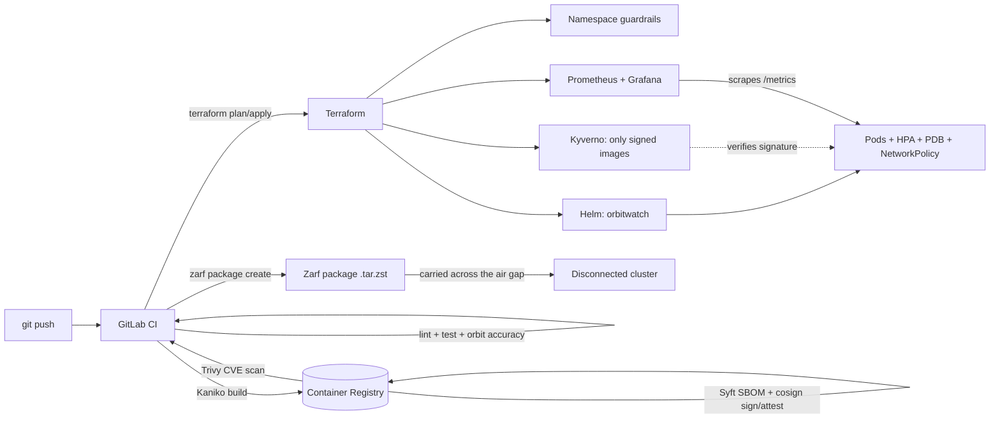

# OrbitWatch


**Satellite tracking and ground-station pass prediction, shipped the way a space/defense
platform team would ship it:** containerized, deployed to Kubernetes with Helm and
Terraform, automated with GitLab CI/CD, monitored with Prometheus and Grafana,
supply-chain secured (SBOM, cosign signatures, admission policy), and deliverable to
disconnected networks with **Zarf**.

- Propagates real orbits with **SGP4** from standard **TLE** data (the same model and format U.S. Space Force publishes)
- Predicts **when each satellite passes over a ground station** (AOS / TCA / LOS, max elevation, azimuths), the core scheduling problem in space communications
- Orbit math is **verified against [Skyfield](https://rhodesmill.org/skyfield/)**, an independent astronomy library, in the test suite

> **Why I built this:** *[Write 2–3 sentences in your own words: what drew you to space
> communications, what you wanted to learn, and what you'd build next.]*



## API

| Endpoint | Purpose |
|---|---|
| `GET /satellites` | The catalog: NORAD ID, name, inclination, period, TLE epoch and age |
| `GET /telemetry/{norad_id}` | Where the satellite is right now: lat/long, altitude, speed |
| `GET /stations` | Configured ground stations |
| `GET /passes/{norad_id}?station=colorado-springs&hours=24&min_elevation=10` | Upcoming passes: AOS, TCA, LOS, duration, max elevation, rise/set azimuth; flags passes already in progress or still in progress at the window's edges |
| `GET /healthz`, `GET /readyz` | Kubernetes liveness / readiness probes |
| `GET /metrics` | Prometheus metrics, including **TLE age** per satellite |

Example: the highest pass of demo satellite 99904 over Colorado Springs in the 12 hours
after 2026-10-15 06:00 UTC (real output from `predict_passes`):

```json
{
  "aos": "2026-10-15T13:57:52+00:00",
  "tca": "2026-10-15T14:01:03+00:00",
  "los": "2026-10-15T14:04:15+00:00",
  "duration_s": 383,
  "max_elevation_deg": 45.1,
  "aos_azimuth_deg": 210.3,
  "los_azimuth_deg": 62.6,
  "truncated": false,
  "started_before_window": false
}
```
It rises in the southwest (210°), peaks at 45° up, and sets in the northeast (63°), so an
antenna there has a 6-minute contact window.

### Orbital data

The image ships with **demo TLEs** (catalog numbers 99901–99904, clearly labeled, not real
satellites) so it works fully offline. For real satellites:

```bash
./scripts/update-tle.sh                       # ISS + space stations from CelesTrak
GROUP=gps-ops ./scripts/update-tle.sh         # or any CelesTrak group
helm upgrade orbitwatch charts/orbitwatch --reuse-values --set-file tle.data=data/current.tle
```

TLEs go stale (positions drift by roughly a kilometer or more per day), so `orbitwatch_tle_age_days`
is exported for every satellite and shown on the Grafana dashboard.

## What's in here

| Path | What it does |
|---|---|
| `app/` | FastAPI service: SGP4 propagation, coordinate conversions, pass prediction, tests |
| `charts/orbitwatch/` | Helm chart: limits, HPA, probes, PDB, NetworkPolicy, ServiceMonitor, TLE/station ConfigMap |
| `charts/orbitwatch-policy/` | Kyverno policy: reject OrbitWatch images that aren't signed by the pipeline |
| `terraform/cluster/` | Namespace guardrails, Prometheus/Grafana + dashboard, Kyverno + policy, the app |
| `terraform/aws-k3s/` | Optional single-node k3s cluster on EC2, locked to your IP |
| `zarf/` | Zarf package definition for disconnected delivery |
| `.gitlab-ci.yml` | lint → test → build → scan/SBOM/sign → plan → deploy (manual) → Zarf + bundle |
| `scripts/` | Local cluster, TLE update, Zarf packaging, hand-rolled air-gap bundle/install |
| `monitoring/` | Prometheus values and the Grafana dashboard |
| `docs/` | `LEARNING.md` (how every piece works + interview prep), `AUDIT.md` (review + fixes) |

## Run it

### 1. Just the app

```bash
cd app
python -m venv .venv && source .venv/bin/activate
pip install -r requirements-dev.txt
pytest -q                                   # includes accuracy checks against Skyfield
uvicorn orbitwatch.main:app --port 8080
curl localhost:8080/satellites
curl 'localhost:8080/passes/99901?station=colorado-springs'
```

### 2. On a local Kubernetes cluster

Needs Docker, [k3d](https://k3d.io), kubectl, and Helm. Also works in a GitHub Codespace with Docker-in-Docker.

```bash
./scripts/local-up.sh
kubectl -n orbitwatch port-forward svc/orbitwatch 8080:80
curl localhost:8080/satellites
```

### 3. Everything with Terraform (app + monitoring + optional signing policy)

```bash
# Run ./scripts/local-up.sh first so the cluster and the orbitwatch:local image exist
cd terraform/cluster
terraform init
terraform apply -var="image_registry=" -var="image_repository=orbitwatch" -var="image_tag=local"
terraform output -raw grafana_admin_password
kubectl -n monitoring port-forward svc/monitoring-grafana 3000:80    # log in as admin
```

The signing policy is off by default because locally built images aren't signed. Turn it on
for images built by the pipeline: `-var="enable_image_signature_policy=true" -var="cosign_public_key=$(cat cosign.pub)"`.

### 4. Air-gapped delivery with Zarf

```bash
# Connected side
IMAGE_REF=registry.gitlab.com/<you>/orbitwatch:<sha> TLE_FILE=data/current.tle ./scripts/zarf-package.sh

# Disconnected side (Zarf CLI + its init package carried across too)
zarf init --confirm
zarf package deploy zarf-package-orbitwatch-amd64-0.2.0.tar.zst --key cosign.pub --confirm
```

Zarf stores the image in an in-cluster registry and rewrites image references automatically,
so the Helm chart needs no air-gap changes. `scripts/airgap-bundle.sh` / `airgap-install.sh`
do the same job by hand (skopeo + Helm + SHA-256 + GPG) to show what Zarf automates.

## Security design

- **Supply chain:** Trivy CVE scan, **CycloneDX SBOM** (Syft), image **signed by digest** with cosign plus a **signed SBOM attestation**, and a **Kyverno** policy so the cluster refuses unsigned images. Signing skips the public transparency log on purpose, so verification works offline.
- **Zero-trust network:** default-deny NetworkPolicy; only same-namespace clients and Prometheus may connect, and the app has **no egress at all** (orbital data is mounted, never downloaded at runtime).
- **Pod hardening:** non-root, read-only root filesystem, all capabilities dropped, seccomp, no service account token; passes the `restricted` Pod Security Standard.
- **No secrets in the repo:** kubeconfig, Grafana password, and cosign key come from masked CI variables or are generated by Terraform.
- **Guardrails:** ResourceQuota + LimitRange; zero-downtime rolling updates; PDB; pods spread across nodes.

## Pipeline setup

1. Push to GitLab. Lint, tests, build, scan, and SBOM run automatically.
2. **Signing:** `cosign generate-key-pair`, then add `COSIGN_PRIVATE_KEY` (contents of `cosign.key`), `COSIGN_PASSWORD`, and `COSIGN_PUBLIC_KEY` as masked CI variables. Never commit `cosign.key`.
3. **Deploys:** add `KUBECONFIG_B64` (`base64 -w0 ~/.kube/config`) and `GRAFANA_ADMIN_PASSWORD` (12+ characters). The runner must reach your cluster's API, so GitLab's shared runners can't reach a home cluster; register your own [GitLab Runner](https://docs.gitlab.com/runner/).
4. On `main`, `terraform-apply` waits for you to click ▶. Zarf and bundle artifacts are attached to each `main` pipeline.

## Roadmap

- Argo CD or Flux (GitOps) instead of push-based deploys
- Alert rules: error rate, p95 latency, TLE older than 3 days
- Pin the base image by digest (or use a hardened base image)
- A pass-scheduling endpoint that resolves conflicts between satellites competing for one antenna

See [`docs/AUDIT.md`](docs/AUDIT.md) for the full review of this project and what was fixed.
